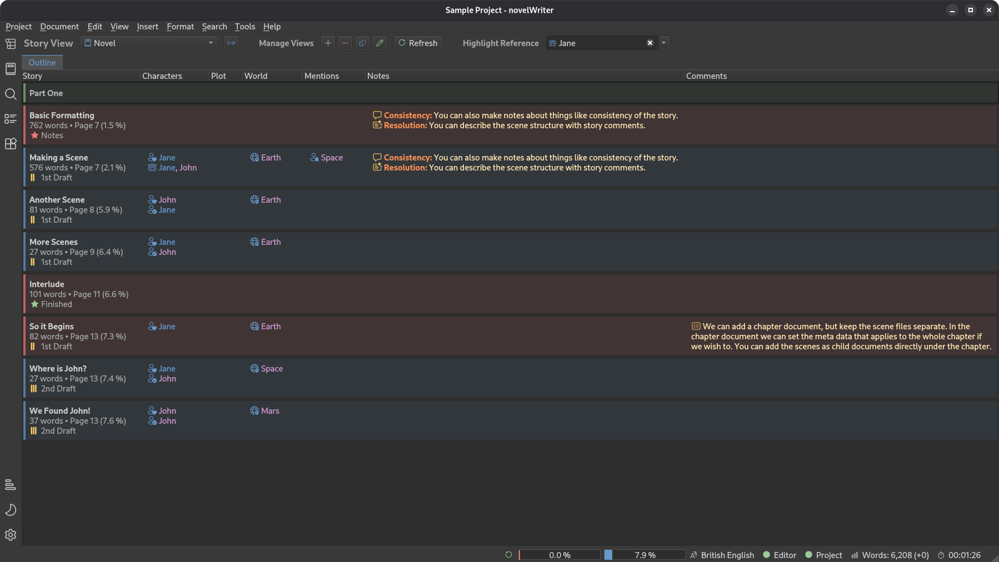

.. _main_release_26_3:

*************************
Pre-Release 2026.3 Beta 1
*************************

| **Release Date:** 20 October, 2026

Release Notes
=============

This release replaces the old Outline panel with a brand new Story View, and adds basic support for right-to-left
languages. The text editor gains simple lists, text alignment buttons, and proper Markdown links including file links.
There are also new page layout options for book printing, better handling of copied projects and backups, and a
refreshed set of icon themes.

.. attention::

   This is a beta release of the next release version, and is intended for testing purposes. Please be careful when
   using this version on live writing projects, and make sure you take frequent backups.

   You can follow the development progress on the `26.3 RC 1 Milestone <https://github.com/vkbo/novelWriter/milestone/122>`__.

The New Story View
------------------

The Outline panel has been redesigned from scratch as the new **Story View** panel. The plan is to add several different
views of your story here over time, and the first one is an outline table. Synopsis text now wraps over multiple lines,
so you can read the full synopsis of several scenes and chapters side by side.

Each entry also shows how far into the story it lands, as a percentage of either the current word count or your project
word goal, whichever is larger. This makes it easy to see at a glance where key scenes fall and keep an eye on the
pacing of your novel, even before your first draft is finished. This replaces the old Novel Details tool, which has been
removed.

Comments and references can be shown as compact icons instead of text labels, with the full label in a tooltip.
Point-of-view and focus characters have their own dedicated icons, so they stand out from other characters. You can also
choose to show each document's status, inactive partitions, and word counts that include sub-headings. To open a
document from the Story View, middle click or double click it, or use the keyboard shortcut.

Each column in the table can show up to five values from your project, whether they are references, your own notes,
story structure comments, or summaries. You can assemble the view however you like, and you can add multiple outline
views if you want to focus on different types of information in each view.

Right-to-Left Support
---------------------

novelWriter now has basic support for writing in right-to-left languages, such as Arabic, Hebrew, Persian, and Urdu. A
new setting in **Project Settings** enables laying out your text right-to-left. The user interface follows the direction
of the selected translation, but you can also force a right-to-left interface in **Preferences**. In a right-to-left
interface, toolbars, menus, panels, and icons are mirrored.

In the editor, each paragraph is laid out in its own direction, so paragraphs in a left-to-right language mixed into
your text still display correctly. The viewer, manuscript preview, and all export formats follow the direction of the
project. Right-to-left books are bound on the right, and EPUB pages turn from right to left.

Since this is a first implementation, feedback from people writing in right-to-left languages is especially welcome,
in particular on how manuscripts look when opened in LibreOffice and Word.

Text Editor Features
--------------------

Several new formatting features have been added to the text editor:

* You can now write simple bullet lists by starting a line with ``*``, and numbered lists by starting a line with
  ``#.``. When you press :kbd:`Enter` at the end of a list item, the editor continues the list for you. Lists pasted
  from other applications as formatted text are converted automatically.
* New toolbar buttons and menu entries have been added for lists, and for left, centre and right text alignment.
* Links can now be written as ``[text](url)``, so you can give them a readable label. Links to files on your computer,
  using ``file://`` addresses, are also supported. A new link button, menu entry, and dialog in the editor help you
  insert them, and web addresses dragged and dropped into the editor are turned into links.

Manuscript Features
-------------------

For those preparing a manuscript for printing as a paperback or hardcover book, there are new page layout settings for
Open Document and Word Document manuscripts in **Manuscript Build Settings**:

* A gutter can be added to the inner margin, to leave room for the binding.
* A new setting called double-sided pages turns the left and right margins into inner and outer margins, which alternate
  between even and odd pages, and lets you set a separate header for even pages.
* The page break setting for headings now has "No Break", "Any Page" and "Odd Page" options, so that chapters can be set
  to always start on an odd-numbered (right-hand) page.

There is also a new option in the Heading Format section to insert each document's status label below its headings.
This is useful when you review an exported draft, as you can see at a glance how far along each part of it is.

Copied Projects and Backups
---------------------------

novelWriter now handles copies of projects better. Previously, if you opened a copy of a project, for instance from a
backup, it would replace the original in the recent projects list on the Welcome dialog, since novelWriter assumed the
project had been moved. Now, novelWriter asks you whether the copy should be treated as a separate project, so you can
keep both in the list.

Backups are now also marked as such. When you open a backup made with this release or later, you will be asked whether
you want to restore it, or keep it as a separate copy.

User Interface
--------------

The icon themes have been refreshed. The FontAwesome theme has been replaced by Microsoft's Fluent UI icons, available
in both regular and filled styles, and the Lucide icons have been updated and resized to match the Material icons. The
Remix Icons theme has been removed, as its licence changed and is no longer compatible with novelWriter.

The project tree can now be hidden, giving the editor and viewer the full width of the window. This is useful when you
want to edit one document while referring to another. To hide the tree, click the sidebar button for the tree view that
is already showing, or press :kbd:`Shift+F8`. Selecting a different tree view brings it back.

Many buttons and other controls in the user interface now have proper labels for screen readers.

Other Changes
-------------

* The tag panels below the viewer have a new "Uses" column, showing how many headings refer to each tag. This makes it
  easy to spot characters, locations, and other tags that are not yet used in your story.
* The Novel View can optionally include sub-headings in each heading's word count, so you can see the total length of
  each chapter or part. The setting for this is available from the dotted button in the Novel View header.
* A new option in **Preferences** in the **Advanced** section lets you always save project files with Unix line endings.
  This is useful on Windows if you keep your project under version control with tools like Git, or sync it across
  different operating systems.
* Urdu is now available as a project language in **Project Settings**.

Download Links
==============

.. include:: ../generated/download_pre_release.rst
